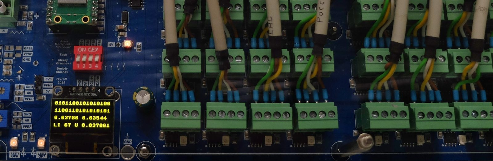
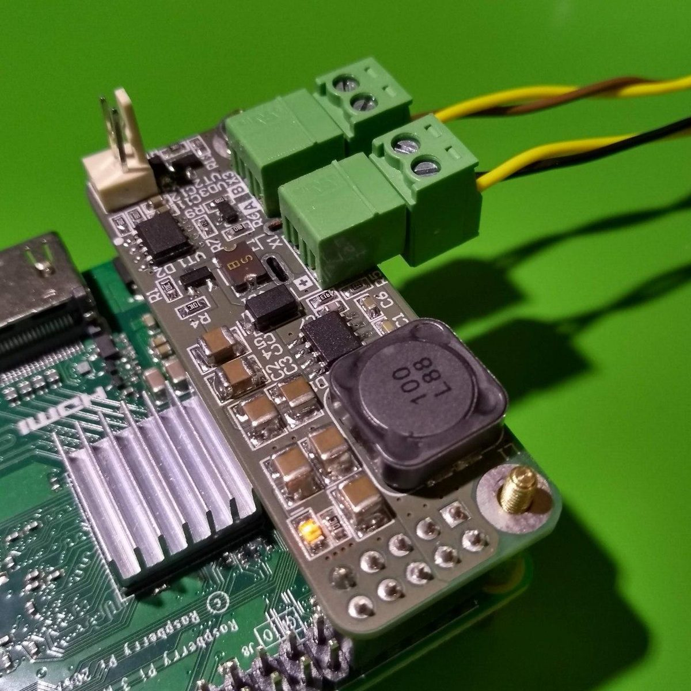
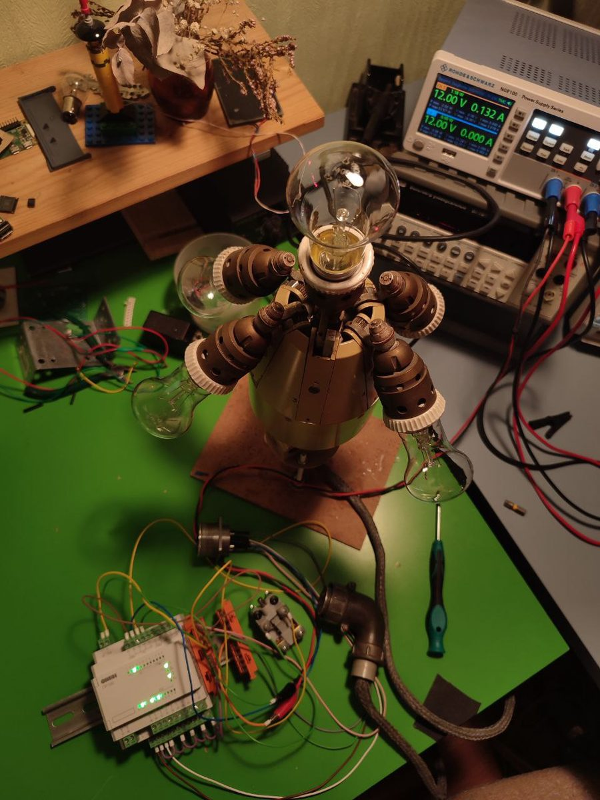
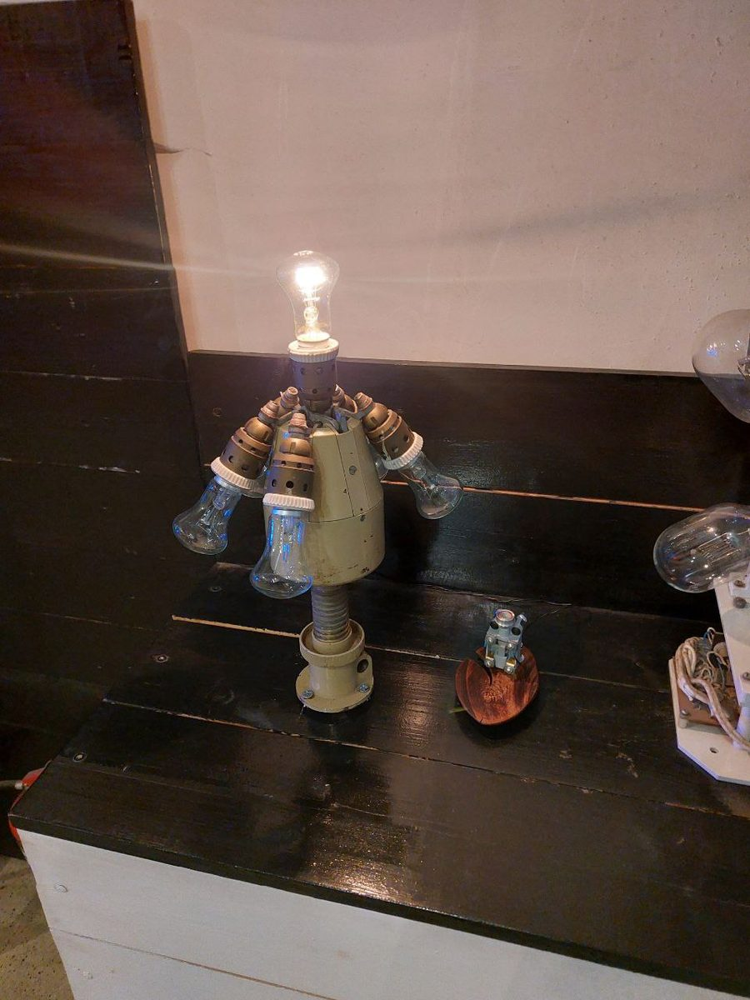
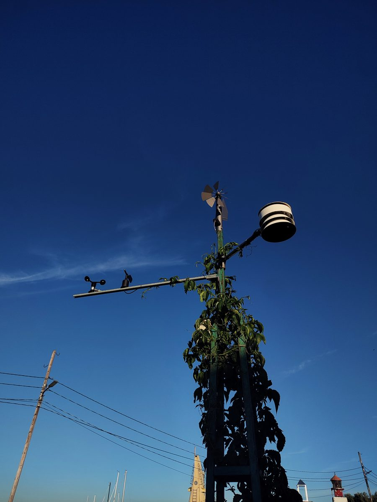
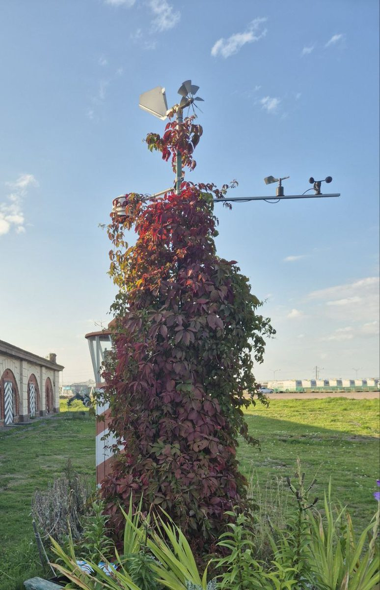
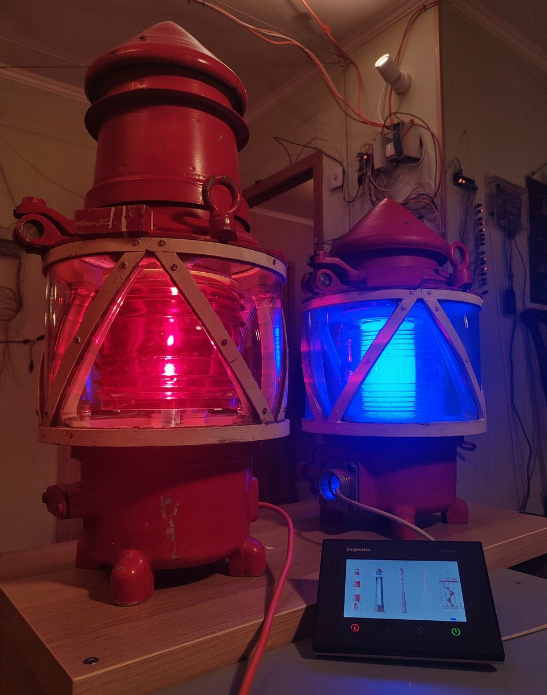
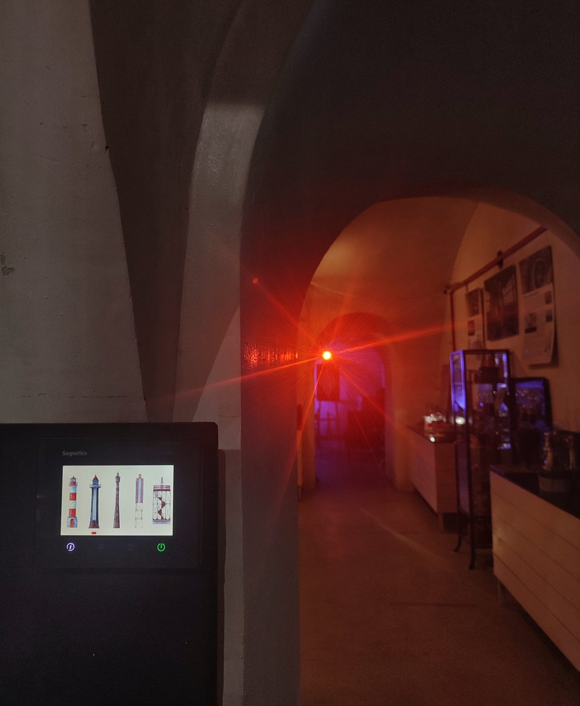
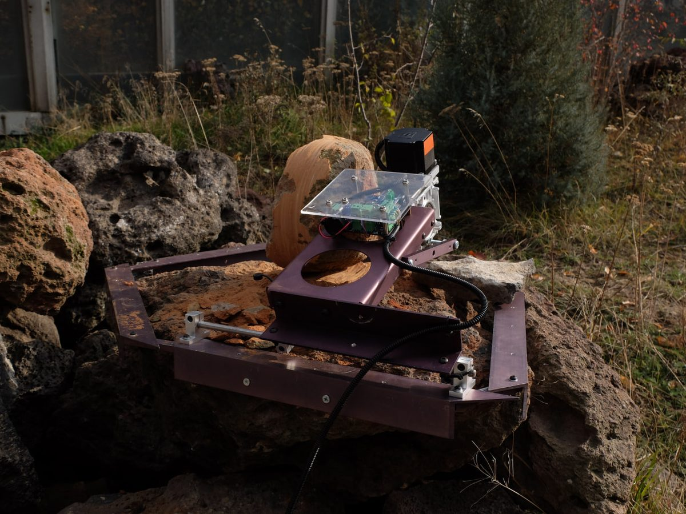
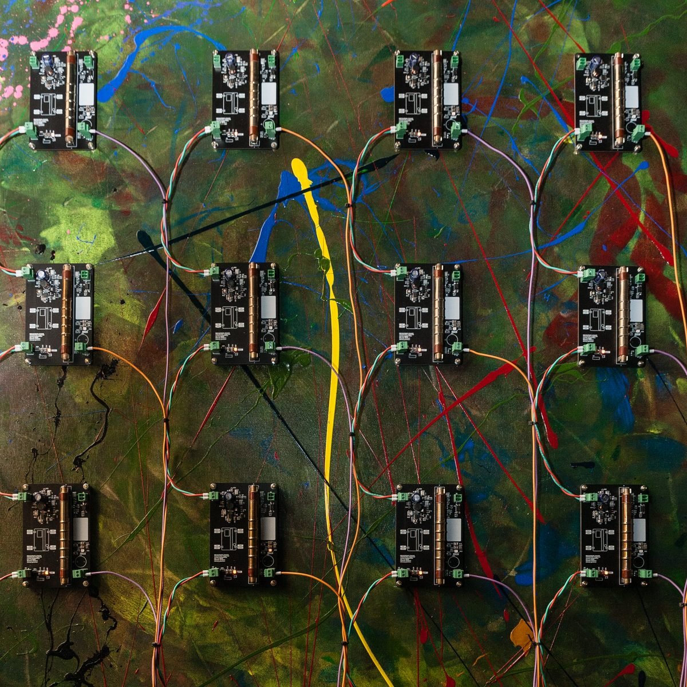

[profile](#profile) · [art](#art) · [projects](#projects) · [gallery](#gallery) · [contacts](#contacts)

---

## profile

Hi! I’m Dima — an electronic engineer passionate about technology, nature, sci-art, and cycling.
My main focuses are PCB development, industrial automation, and IoT, as well as collaborations with artists and my own creative projects.

---

## art

### as an engineer and artist

* [Corrasion][corrasion]
* [The Measure of Chaos][the measure of chaos]
* [Field][field]

### as an engineer

* [Bacteria as a Service][bacteria as a service]
* [Noise Spores][noise spores]
* [Archaean Memory Farm][archean memory farm]

---

## projects

### electronics design

#### PIndustrial — power supply + RS-485 HAT for Raspberry Pi

A Raspberry Pi HAT for industrial use: power supply input and an RS-485 interface on one board.
[Full write-up on Hackster →][pindustrial]

### lighthouse museum projects

#### lighthouse lamp changer restoration

- mechanics restoration, cleaning, and lubrication
- electronic control system design and programming
- integration with the museum weather station for change counting —
  it is now more than 9,000 changes!

#### weather station

Old Soviet weather station restoration:

- mechanics restoration with original parts preserved and reused
- new electronics design for signal acquisition from the old sensors
- server and local PC programming for data storage and visualisation

#### light characteristic demo installation

An interactive installation showing different light characteristics. The visitor chooses a real local lighthouse on the touchscreen, reads a caption about it, and watches its light characteristic on a real lens lantern:

- programming
- user interface design
- lens lantern modification for a custom multicolour LED light

---

## gallery

[][corrasion]
[][the measure of chaos]
[][pindustrial]

---

## contacts

* Telegram: [@dmitriy_shi][telegram]
* Telegram channel: [all_these_things][telegram channel]
* Instagram: [@dm_shsh][insta]
* LinkedIn: [dm-sh][linkedin]
* Email: dmtshsh [at] gmail [dot] com

[insta]: https://www.instagram.com/dm_shsh
[telegram channel]: https://t.me/all_these_things
[telegram]: https://t.me/dmitriy_shi
[linkedin]: https://www.linkedin.com/in/dm-sh
[corrasion]: https://www.cyland.org/made-in-cyland-catalogue/corrasion
[the measure of chaos]: https://www.cyland.org/made-in-cyland-catalogue/the-measure-of-chaos
[field]: https://www.cyland.org/made-in-cyland-catalogue/field-
[pindustrial]: https://www.hackster.io/dm_sh/pindustrial-power-supply-rs-485-hat-for-raspberry-3950f0
[bacteria as a service]: https://annamartynenko.ru/project/2025-random
[noise spores]: https://garagemca.org/ru/open-storage/anna-martynenko-noise-spores
[archean memory farm]: https://wheredogsrun.art/en/2026/04/archaean-memory-farm/
